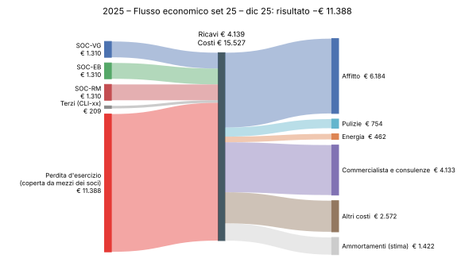
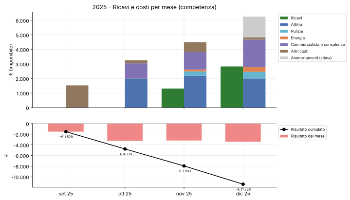
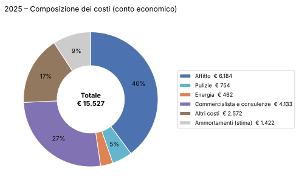
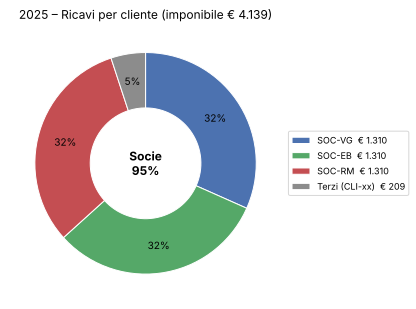
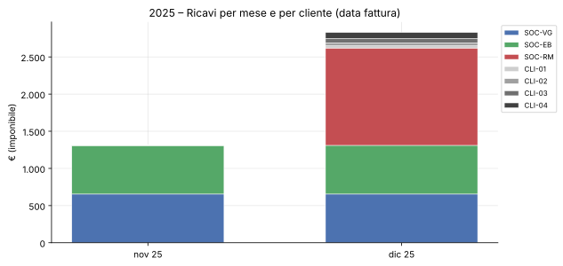
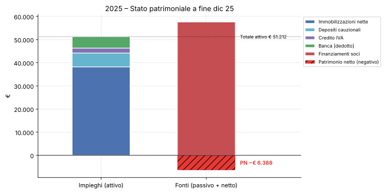
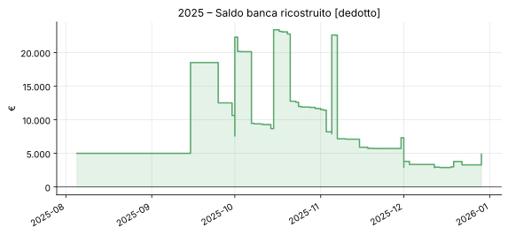
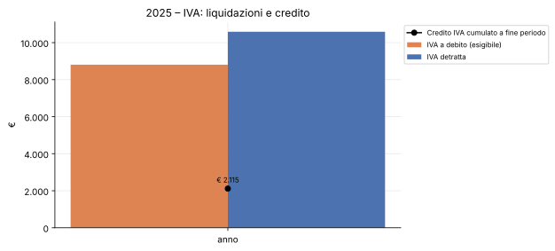
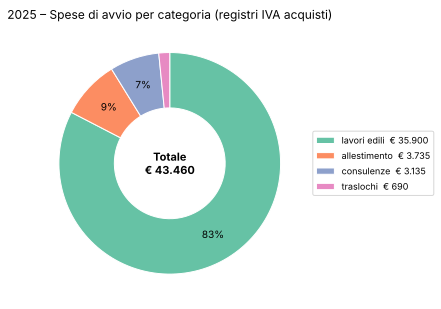
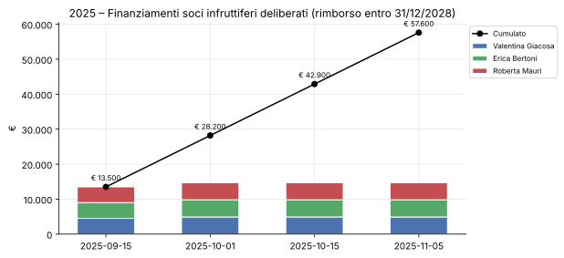

# Grafici 2025

Periodo coperto: set 25 – dic 25. Generati da `scripts/grafici.py`: non modificare a mano. Grado di evidenza dei movimenti: [contabilita/2025/README.md](../../contabilita/2025/README.md).

Indice: [Flusso economico](#flusso-economico) · [Ricavi e costi per mese](#ricavi-e-costi-per-mese) · [Composizione dei costi](#composizione-dei-costi) · [Ricavi per cliente](#ricavi-per-cliente) · [Ricavi per mese e per cliente](#ricavi-per-mese-e-per-cliente) · [Stato patrimoniale](#stato-patrimoniale) · [Saldo banca](#saldo-banca) · [IVA](#iva) · [Spese di avvio](#spese-di-avvio) · [Finanziamenti soci](#finanziamenti-soci)

## Flusso economico

Da chi arrivano i ricavi e dove vanno. Se il risultato è negativo, la perdita compare a sinistra: è la parte di costi coperta dai mezzi delle socie (capitale e finanziamenti). Ammortamenti: **stima**.

## Ricavi e costi per mese

Per competenza, dal libro giornale. Gli ammortamenti sono registrati in un'unica scrittura nell'ultimo mese del periodo.

## Composizione dei costi

Dal bilancio di verifica.

## Ricavi per cliente

Concentrazione: quota dei ricavi che arriva dalle socie.

## Ricavi per mese e per cliente

Dai registri IVA vendite.

## Stato patrimoniale

Impieghi contro fonti. Il saldo banca è **[dedotto]** (mancano gli estratti conto).

## Saldo banca

**[dedotto]**: incassi, pagamenti e versamenti ricostruiti dalle fatture, non dagli estratti conto.

## IVA

Dalle liquidazioni e dalla dichiarazione IVA.

## Spese di avvio

Acquisti con natura `avvio_investimento`; la scelta della categoria è **[dedotto]**.

## Finanziamenti soci

Importi deliberati nei verbali; i versamenti in banca sono **[dedotto]**.
