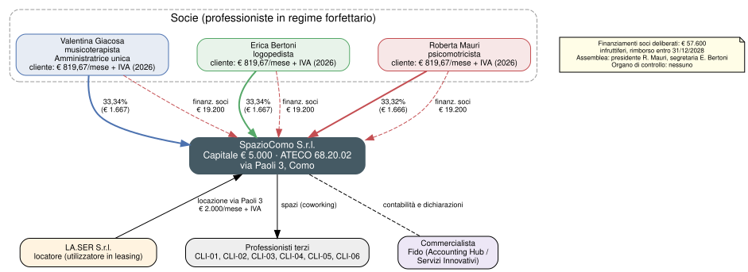
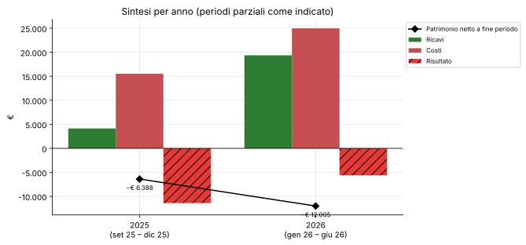
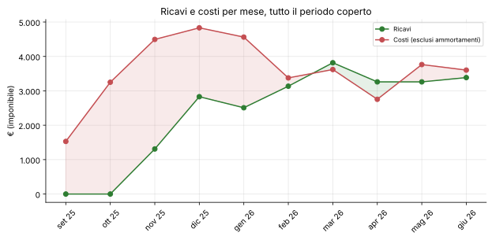
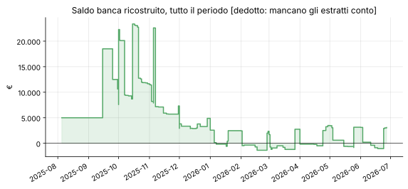

# Grafici

Generati da `scripts/grafici.py` dopo `scripts/partita_doppia.py`: non modificare a mano. Ogni anno ha una pagina con tutti i suoi grafici.

| Anno | Periodo | Grafici |
|---|---|---|
| [2025](2025/README.md) | set 25 – dic 25 | 10 |
| [2026](2026/README.md) | gen 26 – giu 26 | 9 |

## Struttura societaria

Linee piene: quote di capitale. Tratteggio rosso: finanziamenti soci deliberati. Nei riquadri delle socie, il canone che pagano come clienti nell'ultimo anno coperto.

## Sintesi per anno

## Ricavi e costi per mese

## Saldo banca

**[dedotto]**: ricostruito senza estratti conto.
